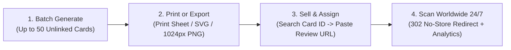

<div align="center">
  
  <h1>QR Studio</h1>
  <p>
    <strong>Dynamic QR Code &amp; Google Review Card Platform</strong><br />
    Pre-print physical cards in bulk, assign customer links after sale, and track scans worldwide — without ever reprinting a code.
  </p>

  <p>
    
    
    
    
    
    
  </p>

  <p>
    <a href="#pre-print--sell-workflow">Workflow</a> •
    <a href="#features">Features</a> •
    <a href="#quick-start">Quick Start</a> •
    <a href="#deploy-to-vercel">Deploy to Vercel</a> •
    <a href="#environment-variables">Environment Variables</a>
  </p>
</div>

---

## Overview

**QR Studio** is a production-ready dynamic QR workspace built for businesses and agencies selling physical **Google Review cards**, table tents, and NFC/QR standees.

Unlike static QR generators, every card encodes a permanent short URL (`/r/<card-id>`). You can batch-print unlinked cards for inventory first, look up a card by its unique **Card ID** when sold, attach the buyer's Google Review URL in seconds, and update destinations anytime with zero cache delay.

---

## Pre-Print & Sell Workflow



1. **Batch Generate Inventory** — Click **Batch cards** to create up to `50` pre-printed cards at once in `Unlinked` state (`#01` … `#50`), up to `1,000` workspace codes.
2. **Print & Export Assets** — Print crisp grid label sheets directly from the browser (`Q` error correction) or download vector `.svg` / `1024×1024` `.png` files for design tools.
3. **Link After Sale** — When a customer buys a card, search its **Card ID** (`ID: ...`), paste their Google Review link (`https://g.page/r/...` or any `https://` URL), and save. The card activates automatically.
4. **Instant Redirects Everywhere** — Every `/r/<code>` response sends strict `no-store` browser and CDN headers (`cache-control`, `cdn-cache-control`, `vercel-cdn-cache-control`) so link updates apply immediately on the next phone scan.

---

## Features

| Capability                  | Details                                                                                                                                                                                   |
| :-------------------------- | :---------------------------------------------------------------------------------------------------------------------------------------------------------------------------------------- |
| **Dynamic Redirect Engine** | Edge/serverless `302` redirects at `/r/<code>` with strict `no-store` caching and helpful status pages when a card is paused or unlinked.                                                 |
| **Scan Analytics**          | Interactive `7d` / `30d` / `90d` timeline charts, mobile/desktop/tablet device breakdown, top-performing cards, referral hosts, and recent scan logs.                                     |
| **Card Inventory Search**   | Instant search across card names, `Card ID` hashes, and destination URLs, plus status filters (`All`, `Active`, `Unlinked`, `Paused`) and pagination.                                     |
| **Smart Scan Origin Bar**   | Automatically encodes your local Wi-Fi LAN IP for phone camera tests during development, supports custom domains (`Custom URL`), and uses your live HTTPS domain in production.           |
| **Zero-Config Database**    | Runs locally on `.data/qr-workspace.json` with atomic writes and switches cleanly to **PostgreSQL** (`DATABASE_URL` / `POSTGRES_URL`) in production with automatic schema initialization. |
| **Optional Admin Passcode** | Set `ADMIN_PASSCODE` in production to lock dashboard management routes with HMAC-signed `HttpOnly` cookies while keeping `/r/<code>` customer scan links 100% public.                     |

---

## Tech Stack

- **Framework**: [TanStack Start](https://tanstack.com/start) + [React 19](https://react.dev) + [TanStack Router](https://tanstack.com/router) + [TanStack Query](https://tanstack.com/query)
- **Server & Build**: [Nitro v3](https://nitro.build) + [Vite 8](https://vite.dev) + [Bun](https://bun.sh)
- **Styling & UI**: [Tailwind CSS v4](https://tailwindcss.com) + [Radix UI](https://www.radix-ui.com) + [Lucide Icons](https://lucide.dev) + [Recharts](https://recharts.org)
- **QR & Data**: [`qrcode.react`](https://github.com/zpao/qrcode.react) + [`postgres`](https://github.com/porsager/postgres) + [Zod](https://zod.dev)
- **Testing & Quality**: [Vitest](https://vitest.dev) + Testing Library + TypeScript + ESLint + Prettier

---

## Quick Start

### Prerequisites

- [Bun](https://bun.sh) (`>= 1.2`) installed locally

### Local Setup

```bash
# 1. Install dependencies
bun install

# 2. (Optional) Copy environment template
cp .env.example .env

# 3. Start development server
bun run dev
```

Open **`http://localhost:8080`** in your browser. QR codes created in local development automatically detect your laptop's Wi-Fi IP (`192.168.x.x` / `10.x.x.x`) so you can test scanning straight from a phone camera on the same network.

---

## Deploy to Vercel

Physical cards printed for customers must encode a permanent HTTPS cloud URL (not `localhost` or a local Wi-Fi IP) backed by cloud Postgres so scans keep working 24/7 worldwide even when your computer is powered off.

<a href="https://vercel.com/new/clone?repository-url=https%3A%2F%2Fgithub.com%2FVishwajit-kamble%2FDynamic-QR-Code&env=ADMIN_PASSCODE&project-name=dynamic-qr-code">
  
</a>

### Step-by-Step Production Setup

1. **Import on Vercel**
   - Import **`Vishwajit-kamble/Dynamic-QR-Code`** at [vercel.com/new](https://vercel.com/new) with Preset **`TanStack Start`** and Root Directory **`./`**.
   - Leave **Build and Output Settings** at default ([`vercel.json`](./vercel.json) runs `bun install` and `bun run build`, and Nitro builds `.vercel/output` automatically).
2. **Add Security Variable (`ADMIN_PASSCODE`)**
   - Under **Environment Variables**, set `ADMIN_PASSCODE` to a strong password so only you can manage QR cards on your live URL.
3. **Connect Cloud PostgreSQL**
   - Add **Neon Postgres** or **Supabase Postgres** from Vercel Storage / Optional Integrations (provides `DATABASE_URL` or `POSTGRES_URL`).
   - On first request, the server automatically creates `public.qr_codes` and `public.qr_scans` — no manual SQL setup needed.
4. **Verify Health Before Printing**
   - Visit `https://<your-domain>/api/health` and confirm it returns:

   ```json
   {
     "ok": true,
     "storageMode": "postgres"
   }
   ```

   - Create/batch-generate your physical cards from your live HTTPS dashboard URL so every printed QR code embeds `https://<your-domain>/r/<card-id>`.

---

## Environment Variables

See [`.env.example`](./.env.example) for the full template:

| Variable         | Required        | Description                                                                                                                                        |
| :--------------- | :-------------- | :------------------------------------------------------------------------------------------------------------------------------------------------- |
| `DATABASE_URL`   | **Production**  | PostgreSQL connection string (also accepts `POSTGRES_URL` or `POSTGRES_PRISMA_URL`). Leave empty locally to use `.data/qr-workspace.json`.         |
| `ADMIN_PASSCODE` | **Recommended** | Secret passcode locking the management UI (`/`). Leave empty locally for instant open access; `/r/<code>` scan redirects remain public either way. |

---

## Scripts

| Command          | Purpose                                               |
| :--------------- | :---------------------------------------------------- |
| `bun run dev`    | Start Vite + TanStack Start dev server with SSR & HMR |
| `bun run build`  | Build production client & Nitro server output         |
| `bun run test`   | Run Vitest unit & component test suite                |
| `bun run lint`   | Run ESLint checks across the codebase                 |
| `bun run format` | Format all project files with Prettier                |

---

## Endpoints

| Route         | Method | Access | Behavior                                                                                                 |
| :------------ | :----- | :----- | :------------------------------------------------------------------------------------------------------- |
| `/`           | `GET`  | Admin  | Dashboard workspace (locked via HMAC `HttpOnly` cookie when `ADMIN_PASSCODE` is set).                    |
| `/r/<code>`   | `GET`  | Public | Logs device type & referrer host, then returns a `no-store` `302` redirect or status page (`404`/`503`). |
| `/api/health` | `GET`  | Public | Reports active `storageMode` (`postgres`, `local-file`, or `unconfigured-serverless`) and timestamp.     |

---

## Export & Print Specifications

- **Permanent Tracking IDs**: Cards receive sequential identifiers (`QR-0001`, `QR-0002`, …) that stay consistent across reprints and batch exports.
- **Error Correction**: Exports use Level `Q` (~25% damage tolerance) with a full 4-module quiet zone for reliable scanning on physical standees and laminated cards.
- **Single & Bulk Downloads**: Download individual `.svg` vectors, `1024×1076` crisp `.png` cards, or an uncompressed `STORE`-mode `.zip` archive of all selected cards.

---

## Project Structure

```text
├── public/                 # Custom QR Studio favicons & robots.txt
├── src/
│   ├── components/
│   │   ├── qr/             # Dashboard views, batch generator, print sheet, preview & editor dialogs
│   │   └── ui/             # Reusable Radix + Tailwind UI primitives
│   ├── lib/
│   │   ├── admin-auth.server.ts       # Optional HMAC-signed passcode session lock
│   │   ├── local-qr-store.server.ts   # Local JSON store & auto-migrating PostgreSQL backend
│   │   ├── qr-workspace.functions.ts  # Type-safe TanStack Start server functions
│   │   └── qr-workspace.ts            # Shared workspace constants & origin/URL validators
│   ├── routes/
│   │   ├── __root.tsx      # Root layout, white-label metadata, custom favicons
│   │   ├── index.tsx       # Workspace dashboard (/ overview & / codes management)
│   │   ├── r.$code.ts      # Fast 302 no-store redirect & scan analytics endpoint
│   │   └── api.health.ts   # Storage readiness endpoint (/api/health)
│   └── test/               # Vitest unit, routing, and React component tests
├── .env.example            # Production environment template
└── vercel.json             # Vercel Bun install & build configuration
```
